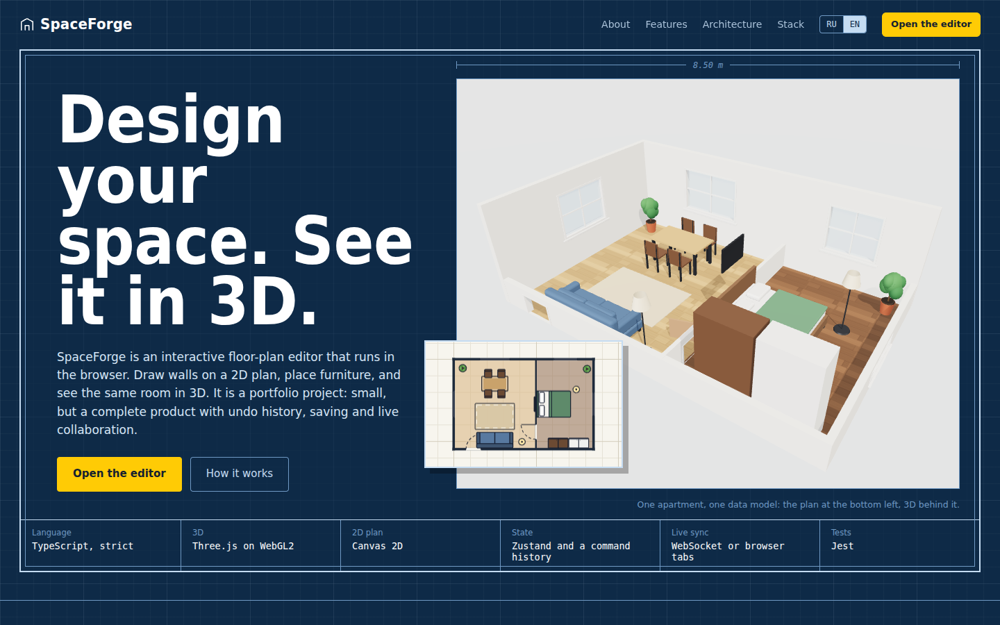
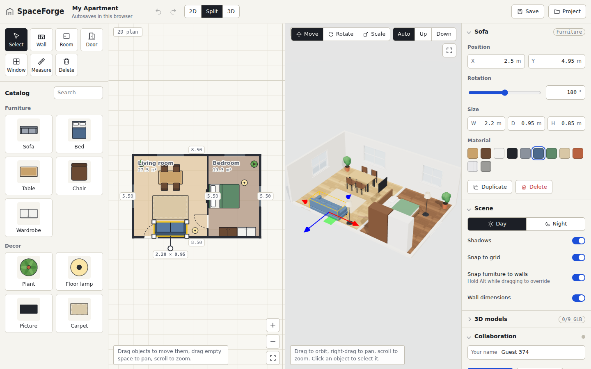
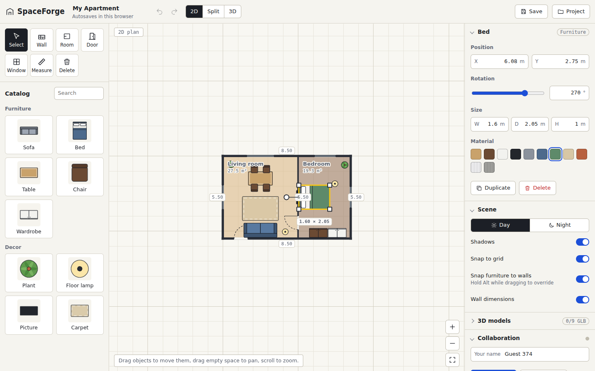
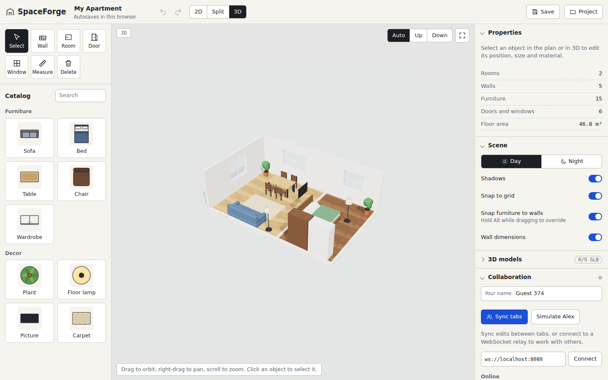
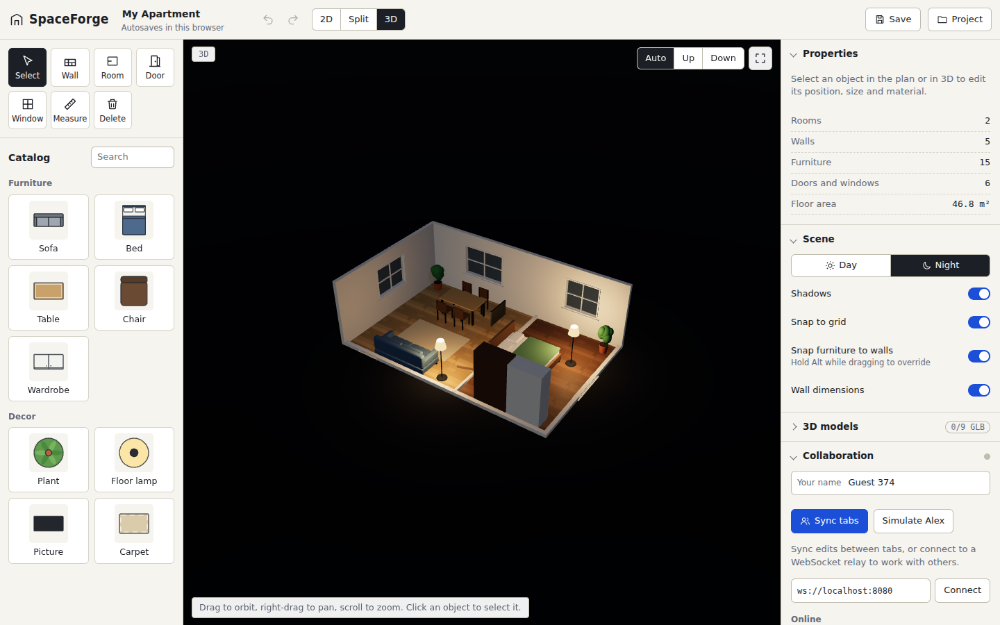
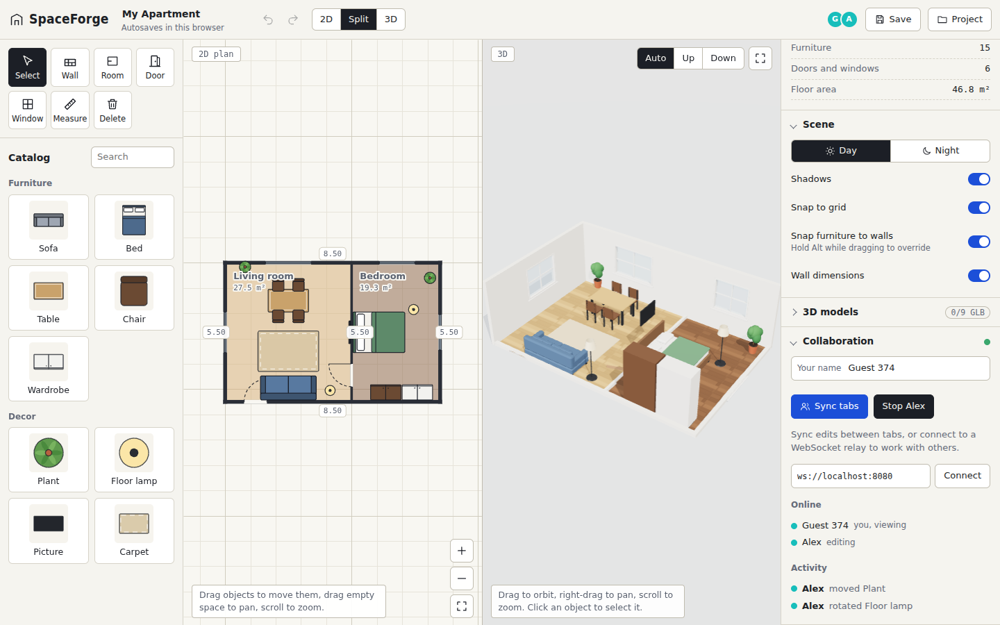

# SpaceForge

[](https://github.com/Amirka314/spaceforge/actions/workflows/ci.yml)
[](LICENSE)


**An interactive 2D / 3D home designer that runs in the browser.** Draw walls on a plan, drop in furniture,
and see the same room in 3D — one data model drives both views, every change can be undone, and several people
can edit together.

### 👉 [Live demo](https://Amirka314.github.io/spaceforge/)  ·  no install needed, open it and press **Open the editor**



> **По-русски.** SpaceForge — интерактивный редактор планировки в браузере: стены рисуются на 2D-плане,
> мебель расставляется перетаскиванием, а та же комната сразу видна в 3D. Проект показывает весь путь
> инженерной задачи: геометрию и 3D-графику, единую модель данных, историю изменений (отмена и повтор),
> сохранение, совместное редактирование по WebSocket и заботу о производительности.
> Лендинг доступен на русском и английском, интерфейс самого редактора — на английском.
> Демо запускается по ссылке выше, локальный запуск описан ниже (раздел «Run locally»).

## Screenshots

| 2D plan and 3D side by side | 2D plan with handles |
|---|---|
|  |  |
| **3D scene (day)** | **3D scene (night, lamps on)** |
|  |  |

**Collaboration** — presence, activity feed and live edits (here a scripted teammate, "Alex", moves furniture):



## What it does

* **2D editor (Canvas 2D):** walls, rooms, doors and windows with grid and corner snapping, live dimensions, a
  measuring tool, handles for rotating and resizing.
* **3D scene (Three.js):** walls with real openings, floors in different materials, shadows, day and night light,
  an orbit camera, and move / rotate / scale handles. Walls between the camera and the room lower automatically.
* **Furniture catalog:** drag items into the plan or straight into 3D. Furniture snaps flush to a wall and turns
  its back to it.
* **Undo / redo** for everything, including drags. **Autosave**, named projects and JSON import / export.
* **Collaboration:** presence, an activity feed, sync over a WebSocket relay or between browser tabs.
* **Performance:** shared geometry and materials, lazy wall rebuilds, hidden views stop rendering, live
  object / vertex / triangle / FPS counters.

### Try it in a minute

1. Open the [live demo](https://Amirka314.github.io/spaceforge/) and press **Open the editor** — a two-room apartment is already there.
2. Pick the **Room** tool and drag a rectangle on the plan: four walls and a floor appear.
3. Drag **Sofa** or **Bed** from the catalog into a room: next to a wall it turns by itself.
4. Switch to **3D** or **Split** and orbit the camera. Select an object in 3D and pull its arrows.
5. Press `Ctrl+Z` to undo anything.
6. Open a second tab, click **Sync tabs** in both — edits appear in each. Or click **Simulate Alex**.

Shortcuts: `1`–`7` tools · `R` rotate · `F` fit view · `Del` delete · `Ctrl+D` duplicate · `Ctrl+S` save · arrows nudge.

## Run locally

Requirements: [Node.js](https://nodejs.org) **22 LTS** (20.19+ works) and Git.

```bash
git clone https://github.com/Amirka314/spaceforge.git
cd spaceforge
npm install
npm run dev          # → http://localhost:5173
```

> **Windows PowerShell:** if `npm` is blocked with "running scripts is disabled", run once
> `Set-ExecutionPolicy -ExecutionPolicy RemoteSigned -Scope CurrentUser` and open a new terminal.

| Command | What it does |
|---|---|
| `npm run dev` | dev server with hot reload |
| `npm test` | Jest tests |
| `npm run typecheck` / `npm run lint` | TypeScript and ESLint |
| `npm run build` | type-check + production build into `dist/` |
| `npm run build:single` | the whole app inlined into one `dist-single/index.html` |
| `npm run ws` | optional collaboration relay on `ws://localhost:8080` |

Open the page with `?debug` (e.g. `localhost:5173/?debug`) to expose the app as `window.__sf` in the console.

## Architecture

**One model, two views.** The plan and the 3D scene never talk to each other. Both are projections of a single
`SceneModel`; they subscribe to its change events and redraw.

```
 React UI ──▶ Editor ──▶ Commands ──▶ SceneModel ◀── Collaboration (remote ops)
                                          │  change events
                          ┌───────────────┼────────────────┐
                     Canvas2DView       ThreeView      ProjectStorage
```

```
src/
├── core/        EventBus, SceneModel (single source of truth), geometry helpers
├── domain/      Entity → Wall, Furniture, Opening (door/window), Room · catalog · materials · demo project
├── editor/      Editor facade, Command pattern (add / remove / update / composite), HistoryManager,
│                SelectionManager, snapping
├── engine/      ThreeView (scene, camera, lights, OrbitControls, TransformControls, raycasting),
│                FurnitureFactory, ModelLibrary (optional GLB), wall/room builders, shared materials, textures
├── view2d/      Canvas2DView (hit-testing, drag, rotate, resize, wall/room/door/window/measure tools)
├── services/    ProjectStorage (localStorage), CollaborationService, transports (BroadcastChannel, WebSocket)
└── ui/          React components; Zustand store for view state (tool, layout, lighting…); landing page
```

Design decisions worth talking about:

* **Document state vs. view state.** The document lives in OOP classes (`Entity` subclasses) with its own history,
  serialisation and sync rules. Zustand only holds view state (active tool, layout, day/night…). React reads the
  model through `useSyncExternalStore`.
* **Command pattern.** Every mutation is a `Command` with `execute()` / `undo()`. Continuous gestures (dragging)
  mutate the model live and commit **one** command through a `Transaction`; rapid edits of one field in the
  properties panel are merged into a single undo step.
* **Origin tagging.** Model changes carry `origin: 'local' | 'remote'`. Remote changes update both views but are
  never re-broadcast and never enter the undo stack.
* **Collaboration.** Local changes are coalesced (40 ms) into `upsert` / `remove` ops. Conflict policy is
  last-write-wins per entity. The oldest session hands its project to a newcomer. The transport is an interface:
  `BroadcastChannel` (other tabs), `WebSocket` (see `server/ws-server.mjs`) or an in-memory hub in the tests.
  "Simulate Alex" runs a scripted teammate through the very same receive path.
* **Geometry.** Furniture snaps flush to a wall and turns its back to it
  (front direction at rotation θ is `(-sin θ, cos θ)`, so facing a wall normal `n` means `θ = atan2(-n.x, n.y)`).
  Walls are extruded slabs with real holes for doors and windows; corners close by extending each wall by half
  its thickness. Dragging a wall end moves every wall end and room vertex that shared that corner.

## Performance

* Furniture templates are built once per kind; every instance is a `clone()` that shares geometry and materials.
* Materials are shared per preset — repainting a sofa swaps a reference.
* Walls and floors are rebuilt lazily, once per frame, however many edits arrived.
* Hidden views stop rendering (2D-only layout pauses the WebGL loop); the plan redraws only when something changed.
* Pixel ratio is capped at 2, frustum culling is on, pointer-driven redraws are coalesced with `requestAnimationFrame`.
* The status bar shows live object / vertex / triangle counts and FPS.

## Tests

`npm test` covers geometry, the scene model (round-trip, events, import validation), undo/redo (including drags,
merged edits and cascading deletes), wall snapping, and collaboration (two models synced through an in-memory hub).
GitHub Actions runs type-check, lint and the tests on every push and pull request.

## Real 3D models (GLB)

Drop `sofa.glb`, `bed.glb`, `table.glb`, `chair.glb`, `wardrobe.glb`, `plant.glb`, `lamp.glb`, `picture.glb`,
`carpet.glb` into `public/models/` and reload — they replace the procedural furniture, item by item.
Each model is normalised on load (centred, standing on the floor, scaled into the catalog box), so resizing,
snapping and the 2D plan behave exactly as before. Draco and Meshopt compressed files are supported.
The **3D models** panel in the editor shows what was found, lets you turn a model by 90° if its front faces
the wrong way, and copies a `models.json` with the result. See `public/models/README.txt`.
Missing files show up as harmless 404s in the network log of a static server.

## Deploy

**GitHub Pages (automatic).** The workflow in `.github/workflows/ci.yml` builds the site and publishes it after
every push to `main`. One-time setup: repository **Settings → Pages → Source: GitHub Actions**.
The site appears at `https://Amirka314.github.io/spaceforge/`.

**Docker.**

```
docker build --target web -t spaceforge .           # nginx serving dist/
docker build --target ws  -t spaceforge-ws .        # WebSocket relay
docker compose up                                   # web on :8080, relay on :8081
```

## Known simplifications

* Furniture ships as procedural stand-ins (Three.js primitives); real GLB models are optional, see above.
  GLB items keep their own materials, so the material picker is hidden for them.
* The UI is plain React + Three.js rather than React Three Fiber; the engine deliberately stays framework-free.
* Rooms are polygons drawn as rectangles; arbitrary polygon rooms need a wall-loop detector.
* No collision detection between furniture, no multi-select.
* Collaboration is a demonstration: no accounts, one shared room per relay, nothing stored on the server.
* The Docker files were not built during development; the WebSocket relay was tested with two browser contexts.
* The editor interface is English only (the landing page has Russian and English).

## Browsers

Needs WebGL2 or WebGL; without it the 2D editor still works and the 3D pane explains why it is unavailable.
Developed and smoke-tested in Chromium. 
## License

[MIT](LICENSE)
